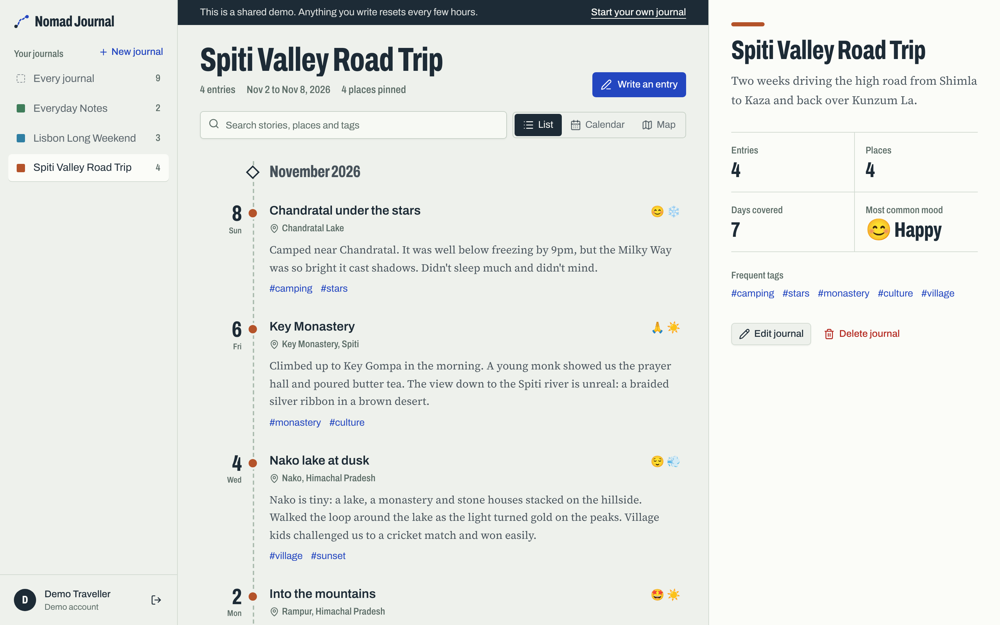

# Nomad Journal

A travel journal that keeps each story tied to the place it happened. Write entries with mood, weather, tags and a map pin, then read a trip as a timeline, a calendar, or a route across the map.

**Live demo: [nomad-journal.vercel.app](https://nomad-journal.vercel.app)**. Click "Open the demo journal" to explore a sample account without signing up.



## Features

- **Journals** for each trip or theme, each with its own colour
- **Entries** with a story, date, mood, weather, tags and a location (search a place, click the map or use your current position)
- **Three views**: a timeline list, a month calendar, and a map that joins each journal's stops into a dashed route in date order
- **Search** across titles, stories, places and tags
- **Accounts** with JWT sessions in httpOnly cookies, optional email verification, and a profile page
- **One-click demo** that signs visitors into a shared sample account, refreshed every few hours
- Works on phones: the three columns collapse into one, and entries open full screen

## Tech stack

| Layer | Choice |
| --- | --- |
| Framework | Next.js 15 (App Router), React 19, TypeScript |
| API | Next.js route handlers, versioned REST under `/api/v2`, OpenAPI 3 spec |
| Data | MongoDB Atlas with Mongoose |
| Validation | Zod at every API boundary |
| Auth | JWT in an httpOnly cookie, bcrypt password hashing |
| State | Zustand for shared dashboard state |
| UI | Tailwind CSS v4, Radix primitives, Leaflet maps |
| Tests | Vitest (41 tests), GitHub Actions CI |
| Hosting | Vercel (Mumbai region, next to the database) |

## Architecture

```
src/
  app/            pages and API route handlers (/api/v2/...)
  controllers/    turn HTTP requests into service calls and responses
  services/       business rules: ownership checks, search, demo seeding
  models/         Mongoose schemas
  schemas/        Zod request schemas (shared rules for create and update)
  lib/            auth wrapper, JWT helpers, error handling, API client
  store/          Zustand store that keeps the three dashboard columns in sync
  components/     dashboard, map and UI components
tests/            controller, service and auth tests
```

A few decisions worth calling out:

- **Ownership is enforced in the service layer.** Every query is scoped to the logged-in user, and writing an entry into a journal checks that the journal is yours first. Anything you don't own returns 404, not 403, so ids can't be probed.
- **Partial updates only touch the fields sent.** Create and update share field rules, but defaults live only on create, so editing an entry's mood can't reset its story. Sending `null` clears an optional field.
- **The database connection is cached** across serverless invocations instead of reconnecting per request.
- **Email is optional.** With SMTP configured, new accounts must verify their email; without it, they're verified on sign-up, which keeps local setup and the demo simple.

## API

Interactive docs are served at [`/api-docs`](https://nomad-journal.vercel.app/api-docs) from [`openapi.yaml`](openapi.yaml).

| Method | Path | Purpose |
| --- | --- | --- |
| POST | `/users/register`, `/users/login`, `/users/logout` | Accounts and sessions |
| POST | `/users/demo` | Sign in to the demo account |
| GET, PATCH | `/users/me` | Current user and profile |
| GET, POST | `/journal` | List or create journals |
| GET, PATCH, DELETE | `/journal/:id` | One journal (delete removes its entries) |
| GET, POST | `/entries?journalId=&q=` | List, filter, search or create entries |
| GET, PATCH, DELETE | `/entries/:id` | One entry |

## Running locally

Requires Node.js 22 and a MongoDB database (a free [Atlas](https://www.mongodb.com/atlas) cluster works).

```bash
npm install
cp .env.example .env.local   # then set MONGO_URL and JWT_SECRET
npm run dev
```

Open http://localhost:3000.

| Script | What it does |
| --- | --- |
| `npm run dev` | Start the dev server |
| `npm test` | Run the test suite |
| `npm run lint` | ESLint |
| `npm run typecheck` | TypeScript, no emit |
| `npm run build` | Production build |

## Environment variables

| Name | Required | Notes |
| --- | --- | --- |
| `MONGO_URL` | Yes | MongoDB connection string |
| `JWT_SECRET` | Yes | Long random string, e.g. `openssl rand -hex 32` |
| `DOMAIN` | No | Public URL, used in verification emails |
| `SMTP_HOST`, `SMTP_PORT`, `SMTP_USER`, `SMTP_PASSWORD`, `EMAIL_FROM` | No | Turn on email verification |

---

Designed and built by [Aryan Namdev](https://aryannamdev.online).
